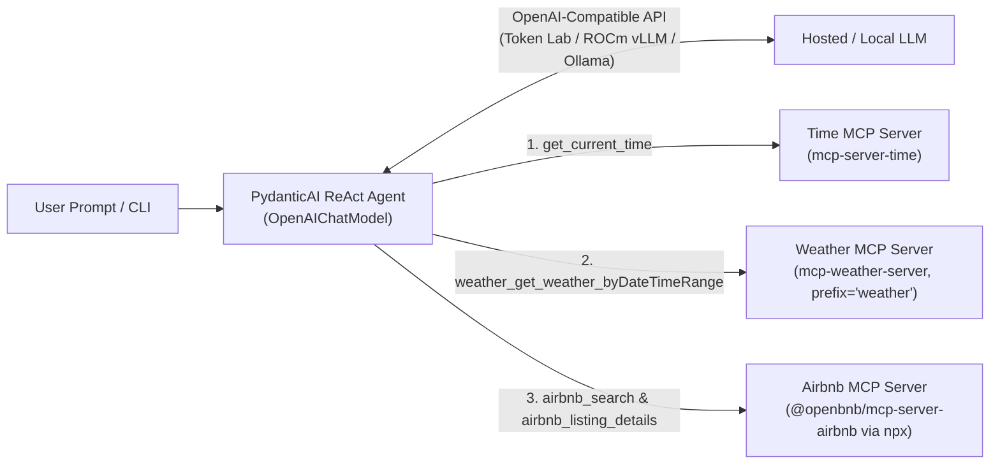

# PydanticAI Multi-MCP ReAct Agent (`M = 3`)

[](./LICENSE)
[](https://www.python.org/)
[](https://ai.pydantic.dev/)
[](https://modelcontextprotocol.io/)
[](https://github.com/Goldcode1618/amd-heterogeneous-ai-lab)

A standalone, portable, and production-hardened **ReAct AI Agent** built with **PydanticAI** (`pydantic-ai-slim[mcp]==1.66.0`) that orchestrates **$M = 3$ Model Context Protocol (MCP) servers** simultaneously over any OpenAI-compatible inference endpoint — including **AMD Token Lab** (`Gemma-4-31B-IT`), **ROCm `vLLM` on AMD Instinct MI300X** (`Qwen3-30B-A3B`), **Ollama**, and **LM Studio**.

Developed as the reference agentic architecture for **AMD AI Academy (`ACAD-B05` AI Agents 101 & `ACAD-B06` AI Agents 201)** and part of the [`Goldcode1618/amd-heterogeneous-ai-lab`](https://github.com/Goldcode1618/amd-heterogeneous-ai-lab) research ecosystem.

---

## Architecture & ReAct Orchestration Flow

The agent binds three independent `MCPServerStdio` toolsets into a unified PydanticAI `Agent` and resolves tool-name collisions deterministically by applying `tool_prefix="weather"` to `mcp-weather-server` (preventing `convert_time` collision with `mcp-server-time`).



### Orchestrated MCP Servers ($M = 3$)

| # | Server | Transport / Runtime | Tool Prefix | Role in ReAct Cycle |
|---|---|---|---|---|
| 1 | **Time MCP Server** | `python -m mcp_server_time --local-timezone=...` (`stdio`) | *None* | Grounding current date, day-of-week, and local IANA timezone (`get_current_time`). |
| 2 | **Weather MCP Server** | `python -m mcp_weather_server` (`stdio`) | `"weather"` | Keyless forecast lookup (`weather_get_weather_byDateTimeRange`) without `convert_time` collision. |
| 3 | **Airbnb MCP Server** | `npx -y @openbnb/mcp-server-airbnb --ignore-robots-txt` (`stdio`) | *None* | Accommodation search (`airbnb_search`) and listing inspection (`airbnb_listing_details`). |

---

## Repository Structure

```text
.
├── .github/workflows/ci.yml   # Automated pytest CI (Python 3.12 + Node.js 20)
├── .env.example               # Template for endpoint, key, model, and timezone
├── .gitignore
├── LICENSE                    # Apache-2.0
├── main.py                    # CLI entrypoint (--check, --prompt, interactive REPL)
├── pyproject.toml             # Package & pytest configuration
├── requirements.txt           # Pinned runtime & test dependencies
├── README.md
├── src/
│   ├── __init__.py
│   ├── agent.py               # ReAct system prompt, OpenAIChatModel wiring & diagnostics
│   ├── config.py              # Pydantic v2 AgentConfig validator & npx PATH verification
│   └── mcp_servers.py         # Factory helpers for Time, Airbnb, and prefixed Weather MCPs
└── tests/
    └── test_agent_setup.py    # Unit tests covering config validation, M=3 factories & prefixing
```

---

## Multi-Backend Endpoint Matrix

Switch between **AMD Token Lab**, **ROCm `vLLM` (MI300X)**, **Ollama**, and **LM Studio** purely via `.env` without modifying Python code:

| Backend / Runtime | Example `BASE_URL` | Example `OPENAI_API_KEY` | Example `MODEL_NAME` | Notes |
|---|---|---|---|---|
| **AMD Token Lab** | `https://api.tokenlab.amd.com/v1` | `<YOUR_TOKEN_LAB_KEY>` | `Gemma-4-31B-IT` | Hosted AMD open-weights inference; verify tool-calling support. |
| **ROCm `vLLM` (MI300X)** | `http://localhost:8000/v1` | `abc-123` | `Qwen3-30B-A3B` | Launch vLLM with `--enable-auto-tool-choice` & appropriate tool parser. |
| **Ollama** | `http://localhost:11434/v1` | `ollama` | `qwen3:30b` | Use an Ollama model tag with native function/tool calling. |
| **LM Studio** | `http://localhost:1234/v1` | `lm-studio` | `qwen2.5-coder-32b-instruct` | Enable **Local Server** on port `1234` with a tool-capable model. |

---

## Installation & Quick Start (English & Panduan Operator Indonesia)

### 1. Prerequisites
- Python `>= 3.10`
- Node.js & `npx` available on system `PATH` (required by `@openbnb/mcp-server-airbnb`)

### 2. Install Dependencies
```bash
pip install -r requirements.txt
```

### 3. Configure `.env`
```bash
cp .env.example .env
```
Edit `.env` with your target endpoint:
```dotenv
BASE_URL=http://localhost:8000/v1
OPENAI_API_KEY=abc-123
MODEL_NAME=Qwen3-30B-A3B
LOCAL_TIMEZONE=Asia/Jakarta
```

### 4. Verify Environment & Endpoint Reachability (`--check`)
Memeriksa ketersediaan `python`, `npx`, modul MCP (`mcp_server_time`, `mcp_weather_server`), validitas konfigurasi, dan keterjangkauan `BASE_URL/models`:
```bash
python main.py --check
```

### 5. Run One-Shot or Interactive Mode
```bash
# One-shot prompt execution
python main.py --prompt "Plan a 3-day trip to Bandung next week for 2 guests based on the best weather window and find Airbnb options."

# Interactive REPL mode (type 'exit' or 'quit' to leave)
python main.py
```

### 6. Run Unit Tests
```bash
pytest -v
```

---

## Author & License
- **Author:** Ahmad Rifa'i Wibisono ([`Goldcode1618`](https://github.com/Goldcode1618)) — Electrical Engineering Researcher & System Architect, UHAMKA
- **License:** [Apache License 2.0](./LICENSE)
