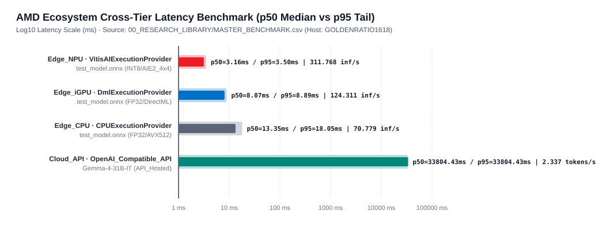

# AMD Heterogeneous AI Lab — Unified Edge-to-Cloud Acceleration & ROCm Engineering

[](./LICENSE)
[](./.github/workflows/ci.yml)
[](./01_LOCAL_RYZEN_AI_1_9/)
[](./03_ROCM_CERTIFIED_ASSOCIATE/)
[](https://github.com/Goldcode1618/pydantic-ai-multi-mcp-agent)

A reproducible, cryptographically audited research and engineering repository spanning the full **AMD AI Hardware & Software Ecosystem** — from local **XDNA 1 NPU** (`Ryzen AI 1.9.0`), **RDNA 3 iGPU** (`DirectML`), and **Zen 4 AVX-512 CPU** on desktop APUs (`AMD Ryzen 5 8600G`) to **AMD Token Lab** hosted open-weights inference and **AMD Instinct MI300X** (`192 GB HBM3`, CDNA 3) datacenter compute.

> **Companion Flagship Repository:** Looking for the standalone **PydanticAI + Multi-MCP ($M = 3$) ReAct Agent** built during `ACAD-B05` / `ACAD-B06`? See [`Goldcode1618/pydantic-ai-multi-mcp-agent`](https://github.com/Goldcode1618/pydantic-ai-multi-mcp-agent) (also archived inside [`02_ACADEMY_CURRICULUM/01_beginner_basics/ACAD-B05_B06_pydantic_mcp_agent/`](./02_ACADEMY_CURRICULUM/01_beginner_basics/ACAD-B05_B06_pydantic_mcp_agent/)).

---

## Empirical Cross-Tier Benchmark Results (`GOLDENRATIO1618` & Cloud)

All experiments are recorded automatically with UUIDv4 identifiers, Git commit provenance, and SHA-256 script hashes into [`00_RESEARCH_LIBRARY/MASTER_EXPERIMENT_LOG.jsonl`](./00_RESEARCH_LIBRARY/MASTER_EXPERIMENT_LOG.jsonl) and [`00_RESEARCH_LIBRARY/MASTER_BENCHMARK.csv`](./00_RESEARCH_LIBRARY/MASTER_BENCHMARK.csv).



### Head-to-Head Local Edge & Token Lab Highlights

| Hardware Tier | Device | Execution Provider / Stack | Workload / Precision | `p50` (ms) | `p95` (ms) | Throughput | Speedup vs Zen 4 CPU |
|---|---|---|---|---:|---:|---:|---:|
| **Edge NPU** | AMD Ryzen 5 8600G NPU (`XDNA 1`) | `VitisAIExecutionProvider` (`'target': 'X1'`) | `test_model.onnx` (`INT8/AIE2_4x4`) | **2.864** | **3.194** | **343.78 inf/s** | **4.66x** (p50) / **4.86x** (throughput) |
| **Edge iGPU** | AMD Radeon 760M (`RDNA 3`) | `DmlExecutionProvider` (`DirectML`) | `test_model.onnx` (`FP32/DirectML`) | 8.074 | 8.894 | 124.31 inf/s | 1.65x (p50) |
| **Edge CPU** | AMD Ryzen 5 8600G (`Zen 4`) | `CPUExecutionProvider` (`AVX-512`) | `test_model.onnx` (`FP32/AVX512`) | 13.349 | 18.052 | 70.78 inf/s | 1.00x (Baseline) |
| **Cloud API** | AMD Token Lab Endpoint | `OpenAI_Compatible_API` | `Gemma-4-31B-IT` (`API_Hosted`) | 33,804.43 | 33,804.43 | 2.34 tokens/s | Cloud 31B Reasoning Tier |

---

## Repository Architecture

| Directory | Purpose | Key Artifacts |
|---|---|---|
| [`00_RESEARCH_LIBRARY/`](./00_RESEARCH_LIBRARY/) | **Single Source of Truth (SSOT)** for research governance & provenance | [`RESEARCH_CHARTER.md`](./00_RESEARCH_LIBRARY/RESEARCH_CHARTER.md), [`MASTER_EXPERIMENT_LOG.jsonl`](./00_RESEARCH_LIBRARY/MASTER_EXPERIMENT_LOG.jsonl), [`MASTER_BENCHMARK.csv`](./00_RESEARCH_LIBRARY/MASTER_BENCHMARK.csv), [`ENVIRONMENT_SNAPSHOTS/`](./00_RESEARCH_LIBRARY/ENVIRONMENT_SNAPSHOTS/), [`REFERENCES_BIBTEX.bib`](./00_RESEARCH_LIBRARY/REFERENCES_BIBTEX.bib) |
| [`01_LOCAL_RYZEN_AI_1_9/`](./01_LOCAL_RYZEN_AI_1_9/) | Local **Ryzen AI 1.9.0** (`XDNA 1` Phoenix/Hawk Point) & **DirectML** head-to-head benchmarks | [`benchmark_directml_vs_npu.py`](./01_LOCAL_RYZEN_AI_1_9/directml_benchmarks/benchmark_directml_vs_npu.py), [`verify_npu_ryzenai.py`](./01_LOCAL_RYZEN_AI_1_9/npu_benchmarks/verify_npu_ryzenai.py), [`install_ryzen_ai_1.9.0_elevated.ps1`](./01_LOCAL_RYZEN_AI_1_9/installers_archive/install_ryzen_ai_1.9.0_elevated.ps1) |
| [`02_ACADEMY_CURRICULUM/`](./02_ACADEMY_CURRICULUM/) | **26-Course AMD AI Academy** implementation tracks (Beginner -> Intermediate -> Advanced RDNA & HIP) | [`COURSE_PROGRESS_LEDGER.md`](./02_ACADEMY_CURRICULUM/COURSE_PROGRESS_LEDGER.md), HIP C++ kernels, Triton RMSNorm, FP8/INT8 QDQ quantizers, vLLM MI300X profiler, Roofline engine, PydanticAI Multi-MCP agent |
| [`03_ROCM_CERTIFIED_ASSOCIATE/`](./03_ROCM_CERTIFIED_ASSOCIATE/) | **ROCm Certified Associate** (Modules 1–5) readiness checks, logs, and technical notes | [`check_rocm_lab_readiness.ps1`](./03_ROCM_CERTIFIED_ASSOCIATE/check_rocm_lab_readiness.ps1), `module_01`–`module_05` [`LAB_NOTES.md`](./03_ROCM_CERTIFIED_ASSOCIATE/module_01_orientation_setup/LAB_NOTES.md) |
| [`04_CLOUD_AND_API_LABS/`](./04_CLOUD_AND_API_LABS/) | **AMD Token Lab** OpenAI-compatible benchmarker & **AMD Developer Cloud MI300X** provisioning | [`test_tokenlab.py`](./04_CLOUD_AND_API_LABS/token_lab/test_tokenlab.py), [`setup_env.sh`](./04_CLOUD_AND_API_LABS/mi300x_dev_cloud/setup_env.sh), [`smoke_test_rocm.py`](./04_CLOUD_AND_API_LABS/mi300x_dev_cloud/smoke_test_rocm.py), [`auto_shutdown_guard.sh`](./04_CLOUD_AND_API_LABS/mi300x_dev_cloud/auto_shutdown_guard.sh) |
| [`05_PUBLICATION_DRAFTS/`](./05_PUBLICATION_DRAFTS/) | Automated LaTeX `booktabs` tables, 300-DPI/SVG figure generators, and IEEE/ACM manuscript draft | [`PAPER_OUTLINE_IEEE_ROCM.md`](./05_PUBLICATION_DRAFTS/manuscripts/PAPER_OUTLINE_IEEE_ROCM.md), [`benchmark_summary.tex`](./05_PUBLICATION_DRAFTS/tables/benchmark_summary.tex), [`generate_figures.py`](./05_PUBLICATION_DRAFTS/figures/generate_figures.py) |
| [`scripts/`](./scripts/) | Centralized SHA-256 experiment logger & Windows host environment snapshotter | [`log_experiment.py`](./scripts/log_experiment.py), [`snapshot_env.ps1`](./scripts/snapshot_env.ps1) |
| [`tests/`](./tests/) | Automated CI verification suite for provenance integrity & Academy reference labs | [`test_research_pipeline.py`](./tests/test_research_pipeline.py) |

---

## AMD AI Academy & ROCm Engineering Highlights (26 Courses)

Full syllabus tracking and experiment IDs are maintained in [`COURSE_PROGRESS_LEDGER.md`](./02_ACADEMY_CURRICULUM/COURSE_PROGRESS_LEDGER.md). Highlights include:

- **HIP C++ Kernel Engineering (`ACAD-I01`, `ACAD-A04`, `ACAD-A05`):**
  - [`saxpy_fma_kernel.hip.cpp`](./02_ACADEMY_CURRICULUM/02_intermediate_systems/ACAD-I01_cuda_to_hip/saxpy_fma_kernel.hip.cpp) — Native HIP `__fmaf_rn` SAXPY kernel targeting `--offload-arch=gfx942,gfx1103`.
  - [`wavefront_reduction.hip.cpp`](./02_ACADEMY_CURRICULUM/03_advanced_rdna_hip/ACAD-A04_wavefront32_vs_64/wavefront_reduction.hip.cpp) — Compile-time wavefront-portable shuffle reduction (`__AMDGCN_WAVEFRONT_SIZE`: `32` on RDNA 3 `gfx1103` vs `64` on CDNA 3 `gfx942`).
  - [`tiled_gemm_lds.hip.cpp`](./02_ACADEMY_CURRICULUM/03_advanced_rdna_hip/ACAD-A05_lds_shared_memory/tiled_gemm_lds.hip.cpp) — Bank-conflict-free `16x16` tiled GEMM using `[TILE][TILE + 1]` Local Data Share (LDS) stride padding.
- **Systems, Quantization & Profiling (`ACAD-B02`, `ACAD-I02`, `ACAD-I05`, `ACAD-I09`, `ACAD-I10`, `ACAD-A02`):**
  - [`int8_qdq_quantizer.py`](./02_ACADEMY_CURRICULUM/01_beginner_basics/ACAD-B02_quantization/int8_qdq_quantizer.py) — Symmetric INT8 weights + asymmetric UINT8 activation calibration (`38.62 dB` output SQNR, `4.0x` compression).
  - [`vllm_serving_benchmark.py`](./02_ACADEMY_CURRICULUM/02_intermediate_systems/ACAD-I02_vllm_mi300x/vllm_serving_benchmark.py) — MI300X `192 GB HBM3` PagedAttention KV-cache capacity model (`Llama-3.1-70B` FP8 -> `85` concurrent `4K` sequences).
  - [`fused_rmsnorm_reference.py`](./02_ACADEMY_CURRICULUM/02_intermediate_systems/ACAD-I05_triton_rocm/fused_rmsnorm_reference.py) — Triton ROCm single-pass fused RMSNorm specification (`3.0x` HBM traffic reduction).
  - [`fp8_bf16_microbench.py`](./02_ACADEMY_CURRICULUM/02_intermediate_systems/ACAD-I09_fp8_mixed_precision/fp8_bf16_microbench.py) — OCP `FP8_E4M3` / `FP8_E5M2` vs `BF16` / `FP16` SQNR & CDNA 3 `2614.9 TFLOPS` scaling analysis.
  - [`edge_npu_cloud_rag_router.py`](./02_ACADEMY_CURRICULUM/02_intermediate_systems/ACAD-I10_hybrid_rag/edge_npu_cloud_rag_router.py) — Sub-3ms local Edge retrieval + complexity router to Cloud LLM.
  - [`roofline_analyzer.py`](./02_ACADEMY_CURRICULUM/03_advanced_rdna_hip/ACAD-A02_rocprofv2_roofline/roofline_analyzer.py) — Cross-tier Roofline model (`MI300X BF16/FP8`, `Radeon 760M`, `XDNA 1 NPU`).

---

## Quick-Start Verification & Reproduction

```powershell
# 1. Run all unit tests (research provenance + Academy reference labs)
pytest -v tests/

# 2. Export updated LaTeX booktabs table & publication SVG/PNG figures
python .\scripts\log_experiment.py summary
python .\scripts\log_experiment.py export-latex
python .\05_PUBLICATION_DRAFTS\figures\generate_figures.py

# 3. Local Edge Head-to-Head (inside Ryzen AI 1.9.0 isolated environment)
cmd /c "`"C:\Program Files\RyzenAI\ryzen-ai-1.9.0\Scripts\activate.bat`" && python .\01_LOCAL_RYZEN_AI_1_9\directml_benchmarks\benchmark_directml_vs_npu.py"
```

---

## Citation & License

If you build upon this benchmark suite or telemetry architecture, please cite [`CITATION.cff`](./CITATION.cff):

```bibtex
@software{wibisono2026amdheterogeneous,
  author       = {Wibisono, Ahmad Rifa'i},
  title        = {Unified Edge-to-Cloud AI Acceleration on the AMD Ecosystem: Empirical Characterization of XDNA 1 NPU, RDNA 3 iGPU, Token Lab API, and Instinct MI300X},
  year         = {2026},
  url          = {https://github.com/Goldcode1618/amd-heterogeneous-ai-lab},
  license      = {Apache-2.0}
}
```

Licensed under the [Apache License 2.0](./LICENSE).
